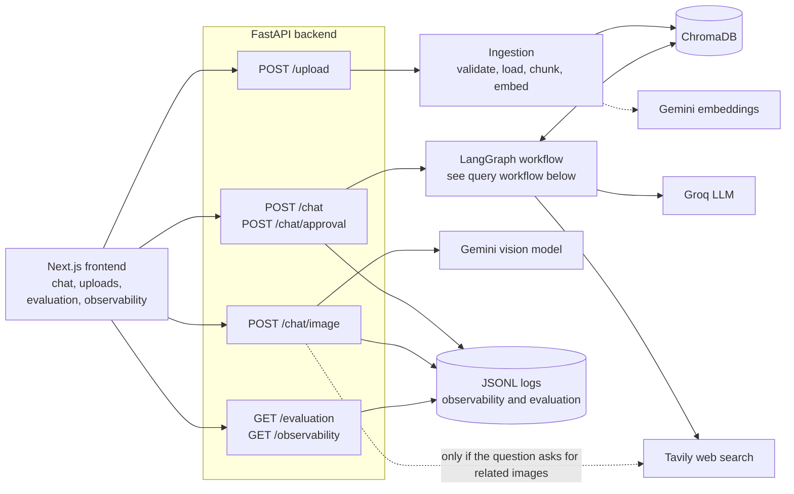
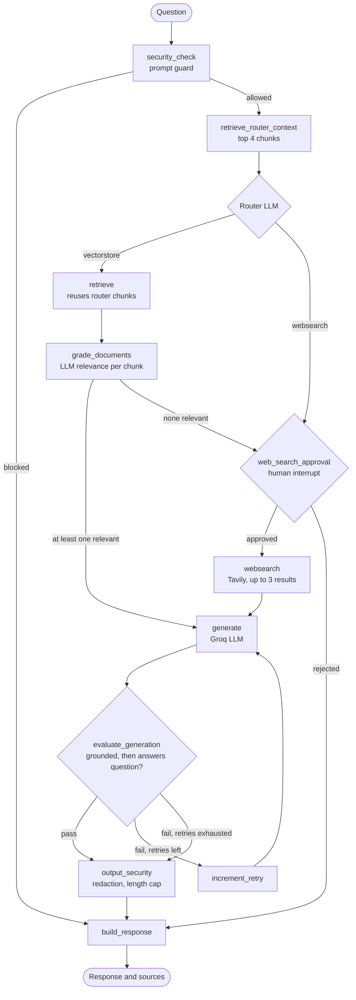
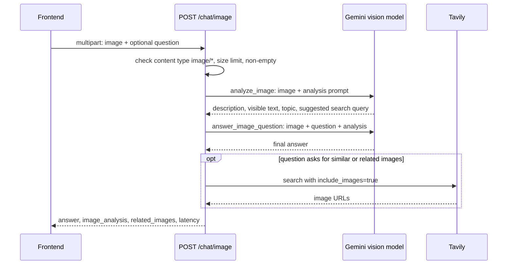

<div align="center">

# Agentic RAG for Image Understanding

**A LangGraph-based adaptive RAG system with a security layer, human-in-the-loop web search, evaluation tracking, and direct multimodal question answering over uploaded images.**


[Source Code](https://github.com/Chittalasailu/agentic-rag-image-understanding) · [API Docs (local)](http://localhost:8000/docs) · [Setup](#installation-and-setup) · [Architecture](#system-architecture)

</div>

> **Deployment status:** no hosted deployment (Vercel, Render or otherwise) is configured in this repository or has been verified, so there is no live demo link. Run it locally using the [setup instructions](#installation-and-setup). The frontend (Next.js, port 3000) and backend (FastAPI, port 8000) are separate processes. A `GOOGLE_API_KEY` (Gemini) and `GROQ_API_KEY` are required; `TAVILY_API_KEY` is needed for web search.

---

## Table of Contents

1. [Overview](#overview)
2. [Key Features](#key-features)
3. [System Architecture](#system-architecture)
4. [End-to-End Workflow](#end-to-end-workflow)
5. [Agentic RAG: Technical Explanation](#agentic-rag-technical-explanation)
6. [Image Understanding Architecture](#image-understanding-architecture)
7. [Technology Stack](#technology-stack)
8. [Repository Structure](#repository-structure)
9. [Installation and Setup](#installation-and-setup)
10. [Configuration Reference](#configuration-reference)
11. [Usage Examples](#usage-examples)
12. [Evaluation and Limitations](#evaluation-and-limitations)
13. [Error Handling, Security, and Reliability](#error-handling-security-and-reliability)
14. [Deployment and Scalability](#deployment-and-scalability)
15. [Future Improvements](#future-improvements)
16. [Contributing and License](#contributing-and-license)
17. [Author](#author)

> **How to read this document.** Everything under "Key Features", "Architecture" and "Workflow" describes behaviour that exists in the code. Anything not implemented is placed under [Future Improvements](#future-improvements) or explicitly labelled as a limitation. Claims were checked against the source files linked throughout.

---

## Overview

This project combines two answering paths behind one web UI:

1. **Document / web Q&A (agentic RAG).** Users upload PDF, DOCX, TXT or Markdown files. A LangGraph workflow screens the question, retrieves local context, lets an LLM decide whether local evidence is sufficient or a web search is needed, grades the evidence, generates an answer, and then checks that answer for grounding and relevance, retrying generation when a check fails.
2. **Image Q&A.** Users upload an image, optionally with a question. A Gemini vision model reads the image directly (including visible text), and answers from the image itself. Related-image search through Tavily is optional and only runs when the question explicitly asks for similar or related images.

**Problem addressed.** A fixed "embed, search, generate" pipeline has no way to notice that retrieval failed, that the answer is unsupported, or that the question needs fresh external information. This project adds explicit decision and verification steps around retrieval, and adds a separate multimodal path for questions that are about an image rather than a document.

**Technically interesting aspects**

- Router decision is **evidence-aware**: the router LLM sees the top retrieved local chunks before choosing `vectorstore` or `websearch`, instead of classifying the question in isolation.
- **Three LLM-based quality gates** (retrieval relevance, hallucination/grounding, answer usefulness) with a bounded retry loop.
- **Human-in-the-loop** approval before any web search, implemented with LangGraph `interrupt` and resumed via `Command(resume=...)`.
- Retrieved and web content is wrapped as **untrusted data** before reaching the generator; user input and model output pass through pattern-based guards.
- Per-run **observability** (JSONL) and **evaluation tracking**, each with its own dashboard page in the UI.

**Who it is for:** developers studying agentic RAG patterns in LangGraph, and anyone who wants a compact, readable reference that includes a security layer, approval flow, evaluation tracking and a multimodal endpoint.

---

## Key Features

| Feature | Status | Where |
|---|---|---|
| Document ingestion (PDF, DOCX, TXT, MD) with SHA-256 de-duplication | Implemented | [`backend/ingestion.py`](backend/ingestion.py) |
| Persistent Chroma vector store with Gemini embeddings | Implemented | [`backend/retrieval.py`](backend/retrieval.py), [`backend/model.py`](backend/model.py) |
| Evidence-aware routing between local retrieval and web search | Implemented | [`backend/graph/graph.py`](backend/graph/graph.py), [`router.py`](backend/graph/chains/router.py) |
| Retrieval relevance grading (per chunk) | Implemented | [`grade_documents.py`](backend/graph/nodes/grade_documents.py) |
| Web search fallback (Tavily) with retries | Implemented | [`web_search.py`](backend/graph/nodes/web_search.py) |
| Human approval gate before web search | Implemented | [`web_search_approval.py`](backend/graph/nodes/web_search_approval.py) |
| Hallucination and answer-quality grading with bounded retries (max 2) | Implemented | `evaluate_generation` in [`graph.py`](backend/graph/graph.py) |
| Prompt-injection screening of user questions | Implemented (regex heuristics) | [`prompt_guard.py`](backend/security/prompt_guard.py) |
| Untrusted-content wrapping for retrieved/web text | Implemented | [`content_guard.py`](backend/security/content_guard.py), [`context.py`](backend/graph/context.py) |
| Output secret redaction and length cap | Implemented | [`output_guard.py`](backend/security/output_guard.py) |
| Source list returned with each answer (local file or web URL) | Implemented | [`sources.py`](backend/sources.py) |
| Image question answering via Gemini vision (with OCR-style text extraction) | Implemented | [`image_search.py`](backend/image_search.py), `POST /chat/image` |
| Optional related-image search (Tavily), keyword-triggered | Implemented | [`image_search.py`](backend/image_search.py) |
| Run observability (JSONL) and evaluation tracking, with UI pages | Implemented | [`observability.py`](backend/observability.py), [`evaluation.py`](backend/evaluation.py) |
| Benchmark runner and RAGAS script | Implemented, not re-verified (see [limitations](#evaluation-and-limitations)) | [`backend/evaluation/`](backend/evaluation) |
| Docker Compose for backend and frontend | Implemented | [`docker-compose.yml`](docker-compose.yml) |
| CLI menu | Implemented | [`backend/main.py`](backend/main.py) |
| Image content indexed into the vector store | **Not implemented** | see [Image Understanding](#image-understanding-architecture) |
| Security guards and quality gates on the image path | **Not implemented** | see [Limitations](#error-handling-security-and-reliability) |
| Authentication, rate limiting, persistent graph checkpoints | **Not implemented** | see [Future Improvements](#future-improvements) |

---

## System Architecture

The diagrams below reflect the call graph in [`backend/api.py`](backend/api.py) and [`backend/graph/graph.py`](backend/graph/graph.py). The text and image paths are **separate**: `/chat` runs the LangGraph workflow, while `/chat/image` calls the vision model directly.

### Component overview



### Query workflow for `POST /chat` (LangGraph)



`POST /chat/approval` resumes a paused run with `Command(resume=approved)`. The maximum number of generation retries is 2; after that the best available answer is returned, flagged by `grounded` and `answers_question`.

### Components

| Component | Responsibility | Data in → out |
|---|---|---|
| **Frontend** (`frontend/src/app`) | Chat UI, document manager, image upload, approval prompt, `/evaluation` and `/observability` pages. Talks to the API at `NEXT_PUBLIC_API_URL`. | User input → HTTP requests |
| **FastAPI app** ([`api.py`](backend/api.py)) | Request validation, CORS, orchestration of ingestion / graph / vision calls, observability and evaluation recording. | HTTP → JSON |
| **Ingestion** ([`ingestion.py`](backend/ingestion.py)) | Load, chunk, hash, embed and store documents. Skips documents whose content hash already exists. | Files → Chroma chunks with metadata |
| **Vector store** ([`retrieval.py`](backend/retrieval.py)) | Chroma collection with a retriever (`k` from config). | Question → top-k chunks |
| **Security layer** ([`backend/security/`](backend/security)) | Input screening, untrusted-content wrapping, output redaction. | Text → allow / block / sanitised text |
| **LangGraph workflow** ([`graph.py`](backend/graph/graph.py)) | Stateful routing, grading, generation, retry, approval. In-memory checkpointer. | Question → answer + metadata |
| **LLM** ([`model.py`](backend/model.py)) | Groq chat model used for routing, all three graders and generation. | Prompts → text / structured output |
| **Vision model** ([`image_search.py`](backend/image_search.py)) | Gemini model that receives the image as base64. | Image + question → answer |
| **Observability / evaluation** | Append-only JSONL records per run; aggregates served to the UI. | Run result → JSONL → summary |

---

## End-to-End Workflow

### Indexing time (`POST /upload`)

1. **Validate.** Max 5 files per request; extension must be `.pdf`, `.docx`, `.txt` or `.md`; size limit from `MAX_UPLOAD_SIZE_MB`; content signature checks (`%PDF-` header, DOCX zip structure, UTF-8 text with no NUL bytes).
2. **Load.** `PyPDFLoader`, `Docx2txtLoader` or `TextLoader`.
3. **Metadata.** Each page/document gets `source`, `file_name`, `file_type` and a SHA-256 `document_id` computed from file contents. A document whose ID already exists in Chroma is skipped.
4. **Chunk.** `RecursiveCharacterTextSplitter` with `CHUNK_SIZE=250` and `CHUNK_OVERLAP=0` by default (characters).
5. **Embed and store.** Chunks are embedded with Google `gemini-embedding-001` and added to the persistent Chroma collection with deterministic chunk IDs.

### Query time (`POST /chat`)

1. **Security check.** [`check_prompt`](backend/security/prompt_guard.py) rejects empty or over-long questions (4,000 chars) and questions matching known injection patterns. Blocked requests skip straight to the response.
2. **Router context.** The top 4 chunks are retrieved and formatted as untrusted evidence (6,000 characters max).
3. **Routing.** A Groq structured-output call returns `vectorstore` or `websearch`, given the question and those chunks.
4. **Local path.** Retrieval reuses the router's candidates. Each chunk is graded `yes/no` for relevance by an LLM call. If **zero** chunks survive, the graph takes the web path.
5. **Web path with approval.** The graph calls `interrupt(...)`. The API responds with `status: "approval_required"` and a `thread_id`. The client calls `POST /chat/approval` with `approved: true/false`. Approved: Tavily returns up to 3 results, added to any existing documents. Rejected: the graph ends with a rejection response.
6. **Generation.** The generator prompt treats context as untrusted evidence and instructs the model to say when evidence is insufficient.
7. **Verification.** A hallucination grader checks the answer against the context; only if it is grounded does an answer grader check it against the question.
8. **Retry or finish.** If either check fails and `retry_count < 2`, generation runs again. After 2 retries the **best available answer is returned anyway** (with `grounded` / `answers_question` flags set accordingly).
9. **Output security.** Known secret patterns and sensitive env-var assignments are redacted; output over 12,000 characters is truncated.
10. **Response.** Answer, deduplicated sources (local files or web URLs), route, retry count, grounding flags, HITL and security status.

---

## Agentic RAG: Technical Explanation

**What is agentic here.** The control flow is a LangGraph `StateGraph` in which LLM calls make *branching decisions*, not just produce text:

| Decision point | Made by | Outcome |
|---|---|---|
| Local vs. web | Router LLM (structured output, sees retrieved chunks) | `retrieve` or `web_search_approval` |
| Is retrieved evidence relevant? | Retrieval grader LLM, per chunk | `generate` or web fallback |
| Is the answer grounded? | Hallucination grader LLM | continue or retry |
| Does it answer the question? | Answer grader LLM | finish or retry |
| May the system search the web? | Human (via `interrupt`) | search or reject |

**What it is not.** Be precise about the design when discussing it:

- It is a **fixed, hand-designed graph with LLM-driven branching**, not an open-ended tool-calling agent. The LLM does not choose among arbitrary tools or plan multi-step actions.
- There is **no query rewriting** and no iterative multi-hop retrieval. Retrieval happens once per question; only *generation* is retried.
- The web-search retry only appends the phrase "reliable current information" to the query.
- Web results are not passed through the retrieval grader; they go directly to generation.
- A suitable description is: *"adaptive RAG with routing, self-grading and human approval, implemented as a LangGraph state machine."*

**Grounding.** Context passed to the generator and to the hallucination grader is the same formatted evidence (each item labelled with its source and wrapped as untrusted). Returned `sources` list the local files or web URLs that fed generation. There are no inline citations in the answer text.

**State and persistence.** `GraphState` ([`state.py`](backend/graph/state.py)) carries question, documents, route, retry count, grading flags, HITL and security fields. The checkpointer is `InMemorySaver`: paused approvals do not survive a backend restart, which the source itself notes should be replaced for production.

---

## Image Understanding Architecture

**Approach: direct multimodal inference** with a Gemini model (default `gemini-2.5-flash`, set by `VISION_MODEL`) through `langchain-google-genai`.



| Aspect | Implementation |
|---|---|
| Accepted input | Any upload whose `Content-Type` starts with `image/`, up to `MAX_UPLOAD_SIZE_MB` (default 25 if unset). Format is not otherwise validated. |
| Preprocessing | None. Bytes are base64-encoded and sent as a data URL. (`Pillow` is listed in `requirements.txt` but not imported anywhere.) |
| Representation | Free-text "image analysis" report from the vision model: depiction, objects/labels, readable text, topic, suggested search query. |
| Text extraction | Performed by the vision model itself, not a separate OCR engine. Accuracy is whatever the model delivers. |
| Answering | Second vision call receives the **original image** plus the question, with the analysis as secondary evidence. Default question if none: "Explain the uploaded image and identify its important content." |
| Prompt-injection stance | Prompts tell the model to treat text inside the image as untrusted data. This is an instruction to the model, not an enforced filter. |
| Related images | Only when the question contains phrases such as "find similar images" or "show related images". Requires `TAVILY_API_KEY`; otherwise returns an empty list. |

**How it interacts with text retrieval.** Currently it does not. Image analysis is **not embedded or stored** in Chroma, and the `/chat/image` route does not invoke the LangGraph workflow, so it does not query uploaded documents and does not pass through the prompt guard, graders or output guard. `GraphState` and `generate` contain an `image_analysis` field that would let the graph consume image context, but nothing in the current graph populates it. Combining the two paths is listed under [Future Improvements](#future-improvements).

**Image-path limitations**

- Each image question makes two Gemini calls (plus up to one Tavily call).
- `grounded` and `answers_question` are hard-coded to `true` in the image response and observability record, so these metrics are not meaningful for image runs.
- No size normalisation, format verification or content scanning of the image.
- Cannot answer questions that need both an image and the user's documents.

---

## Technology Stack

| Component | Technology | Purpose |
|---|---|---|
| Language | Python 3.11 (Docker image), TypeScript | Backend, frontend |
| API | FastAPI, Uvicorn, Pydantic, python-multipart | REST endpoints, uploads |
| Agent framework | LangGraph (StateGraph, `interrupt`, `InMemorySaver`) | Workflow, branching, HITL |
| LLM orchestration | LangChain (`langchain`, `langchain-community`, `langchain-core`) | Prompts, structured output, loaders |
| Text LLM | Groq via `langchain-groq` (default `openai/gpt-oss-120b`) | Router, graders, generation |
| Embedding model | Google `gemini-embedding-001` via `langchain-google-genai` | Chunk and query embeddings |
| Vision model | Google `gemini-2.5-flash` via `langchain-google-genai` | Image analysis and image Q&A |
| Vector database | ChromaDB via `langchain-chroma` | Persistent local vector store |
| Document loaders / splitter | `pypdf`, `docx2txt`, `langchain-text-splitters` | Parsing and chunking |
| Web search | Tavily (`langchain-tavily`, `tavily-python`) | Web fallback and related images |
| Frontend | Next.js 16, React 19, Tailwind CSS 4 | UI |
| Evaluation | Custom benchmark runner, RAGAS (script only) | Quality measurement |
| Testing | Pytest | Unit and workflow tests |
| Infrastructure | Docker, Docker Compose | Containers for backend and frontend |

---

## Repository Structure

```text
.
├── backend/
│   ├── api.py                  # FastAPI app, all HTTP routes
│   ├── main.py                 # Interactive CLI menu
│   ├── config.py               # Env-driven RAG settings
│   ├── model.py                # Groq LLM + Gemini embeddings
│   ├── ingestion.py            # Load, hash, chunk, store, list, delete documents
│   ├── retrieval.py            # Chroma vector store and retriever
│   ├── image_search.py         # Gemini vision analysis / Q&A, Tavily image search
│   ├── sources.py              # Source extraction for responses
│   ├── response.py             # Response helpers
│   ├── evaluation.py           # EvaluationResult / EvaluationTracker
│   ├── observability.py        # RunObserver and JSONL summaries
│   ├── graph/
│   │   ├── graph.py            # StateGraph definition and edge logic
│   │   ├── state.py            # GraphState
│   │   ├── context.py          # Evidence formatting (untrusted wrapping)
│   │   ├── chains/             # router, retrieval/hallucination/answer graders, generation
│   │   ├── nodes/              # retrieve, grade, web search, approval, generate, security, response
│   │   └── tests/              # graph, evaluation and response tests
│   ├── security/               # prompt_guard, content_guard, output_guard, security_config, tests
│   ├── evaluation/             # benchmark dataset, runners, RAGAS script, saved results
│   └── documents/              # sample knowledge-base documents
├── frontend/                   # Next.js app (pages: /, /evaluation, /observability)
├── Dockerfile                  # Backend image
├── docker-compose.yml          # Backend + frontend services
├── requirements.txt
└── .env.example
```

---

## Installation and Setup

### Prerequisites

- Python 3.11+ (the Docker image uses 3.11)
- Node.js 20+ (for the frontend)
- API keys:
  - **Groq** – https://console.groq.com (required: LLM)
  - **Google AI Studio** – https://aistudio.google.com (required: embeddings and vision)
  - **Tavily** – https://tavily.com (required for web search; optional if you never use it)

### 1. Clone

```bash
git clone https://github.com/Chittalasailu/agentic-rag-image-understanding.git
cd agentic-rag-image-understanding
```

### 2. Create a virtual environment and install dependencies

Linux / macOS:

```bash
python -m venv .venv
source .venv/bin/activate
pip install -r requirements.txt
```

Windows (PowerShell):

```powershell
python -m venv .venv
.venv\Scripts\Activate.ps1
pip install -r requirements.txt
```

### 3. Configure environment variables

```bash
cp .env.example .env          # Windows: copy .env.example .env
```

Edit `.env` and fill in `GROQ_API_KEY`, `GOOGLE_API_KEY` and (optionally) `TAVILY_API_KEY`. `.env` is git-ignored; never commit real keys. No model downloads are needed: all models are hosted APIs, and the Chroma index is created in `./.chroma` on first upload.

### 4. Start the backend

```bash
uvicorn backend.api:api --reload
```

Open http://localhost:8000/docs for the interactive API reference, or http://localhost:8000/health for a health check.

### 5. Start the frontend

```bash
cd frontend
npm install
npm run dev
```

Open http://localhost:3000. The frontend reads the API address from `NEXT_PUBLIC_API_URL` (defaults to `http://localhost:8000`).

### Run the CLI instead (optional)

```bash
python -m backend.main
```

---

## Configuration Reference

Defined in [`.env.example`](.env.example) and read in [`config.py`](backend/config.py), [`model.py`](backend/model.py), [`image_search.py`](backend/image_search.py) and [`api.py`](backend/api.py).

| Variable | Purpose | Required? | Example |
|---|---|---|---|
| `GROQ_API_KEY` | Groq LLM access | Yes | `your_groq_key` |
| `GOOGLE_API_KEY` | Gemini embeddings and vision | Yes | `your_google_key` |
| `TAVILY_API_KEY` | Web search and related-image search | For web search | `your_tavily_key` |
| `LLM_MODEL` | Groq model name | No (`openai/gpt-oss-120b`) | `openai/gpt-oss-120b` |
| `LLM_TEMPERATURE` | Generation temperature | No (`0.7`) | `0.2` |
| `LLM_MAX_RETRIES` | Client retries on API errors | No (`2`) | `2` |
| `EMBEDDING_MODEL` | Embedding model | No (`gemini-embedding-001`) | `gemini-embedding-001` |
| `VISION_MODEL` | Image model | No (`gemini-2.5-flash`) | `gemini-2.5-flash` |
| `IMAGE_SEARCH_RESULTS` | Max related images | No (`6`) | `6` |
| `CHROMA_PATH` | Vector-store directory | No (`./.chroma`) | `./.chroma` |
| `COLLECTION_NAME` | Chroma collection | No (`rag-chroma`) | `rag-chroma` |
| `CHUNK_SIZE` / `CHUNK_OVERLAP` | Chunking (characters) | No (`250` / `0`) | `500` / `50` |
| `RETRIEVAL_K` | Chunks retrieved per query | No (`4`) | `4` |
| `MAX_UPLOAD_SIZE_MB` | Upload size limit | No (`25` in code; `.env.example` sets `10`) | `10` |
| `FRONTEND_URL` | Allowed CORS origin | No | `http://localhost:3000` |
| `LANGSMITH_TRACING`, `LANGSMITH_PROJECT`, `LANGSMITH_API_KEY` | Declared in config / `.env.example`. The code does not call LangSmith directly; tracing depends on LangChain's own environment-variable integration, which was not verified here. | No | `false` |

> Note: changing `EMBEDDING_MODEL`, `CHUNK_SIZE` or `CHUNK_OVERLAP` after indexing requires re-indexing (delete `.chroma` and re-upload).

---

## Usage Examples

The commands below match the routes in [`api.py`](backend/api.py). They were derived from the code and **have not been executed against live API keys in this documentation pass**.

### Upload a document

```bash
curl -X POST http://localhost:8000/upload \
  -F "files=@backend/documents/benchmark_knowledge_base.md"
```

### Ask a question about uploaded content

```bash
curl -X POST http://localhost:8000/chat \
  -H "Content-Type: application/json" \
  -d '{"question": "What does this project use Chroma for?"}'
```

### Approve or reject a web search

If a response has `"status": "approval_required"`, resume that thread:

```bash
curl -X POST http://localhost:8000/chat/approval \
  -H "Content-Type: application/json" \
  -d '{"thread_id": "<thread_id from the previous response>", "approved": true}'
```

### Ask a question about an image

```bash
curl -X POST http://localhost:8000/chat/image \
  -F "image=@diagram.png" \
  -F "question=Explain the components in this diagram"
```

### Other endpoints

`GET /documents`, `DELETE /documents/{document_id}`, `GET|DELETE /evaluation`, `GET|DELETE /observability`, `GET /health`.

### Sample response shape (illustrative)

Field names come from the `/chat` handler; the **values are made up** to show the format, not a recorded output.

```json
{
  "status": "completed",
  "thread_id": "3f0c…",
  "question": "What does this project use Chroma for?",
  "answer": "<model-generated answer>",
  "route": "local",
  "sources": [{ "type": "local", "file_name": "chroma.txt", "document_id": "…" }],
  "retrieved_documents": 4,
  "relevant_documents": 2,
  "grounded": true,
  "answers_question": true,
  "retry_count": 0,
  "latency_seconds": 0.0,
  "hitl_status": null,
  "security_status": "passed"
}
```

`/chat/image` returns `route: "image"`, `image_analysis` and `related_images` in addition to the answer.

---

## Evaluation and Limitations

### Existing evaluation

| Item | What it is |
|---|---|
| Unit / workflow tests | 33 test functions in [`backend/graph/tests`](backend/graph/tests), [`backend/graph/chains/tests`](backend/graph/chains/tests) and [`backend/security/tests`](backend/security/tests). Run with `python -m pytest -v`. They were **not re-run** while writing this README. |
| Benchmark runner | [`run_benchmark.py`](backend/evaluation/run_benchmark.py) over an 8-question dataset ([`benchmark_dataset.json`](backend/evaluation/benchmark_dataset.json)) checking route, grounding, answer-quality flag and expected keywords. |
| RAGAS | [`run_ragas.py`](backend/evaluation/run_ragas.py) computes faithfulness and answer relevancy over the local RAG path. |
| Runtime tracking | Every `/chat` and `/chat/image` call is appended to `evaluation_history.jsonl` and `observability_history.jsonl`, summarised in the UI. |

**Saved results in the repository** (from [`final_report.json`](backend/evaluation/final_report.json) and [`ragas_results.json`](backend/evaluation/ragas_results.json); not re-run): on the 8-question set, routing accuracy 0.75, grounded-answer rate 1.0, answer-quality rate 0.875, overall pass rate 0.625; RAGAS faithfulness 0.75, with answer relevancy recorded as `NaN`. The dataset is small, self-authored and mostly asks about this project's own documentation, so these numbers indicate the harness works rather than establishing general accuracy.

### Known limitations

- **No image benchmark.** Nothing measures image-question accuracy or OCR quality.
- **LLM graders are themselves LLM calls** and add latency (one call per retrieved chunk, plus two for generation checks, plus the router call). The saved benchmark reports an average latency of about 26 seconds per question.
- **Evaluation scripts need verification.** `run_benchmark.py` and `run_ragas.py` import `graph.*` with the `backend/` directory added to `sys.path`, while the rest of the code imports `backend.*`. You may need to run them from the repository root with `PYTHONPATH=.` and adjust paths; this was not confirmed.
- **`ragas` is not in `requirements.txt`.** Install it separately to run the RAGAS script.
- **Duplicate definitions in `api.py`.** `load_observability_history`, `clear_observability_history` and `DELETE /observability` are defined more than once, and `process_uploaded_image` is imported but unused. Behaviour is unaffected but the file needs cleanup.
- **Unused dependencies** appear in `requirements.txt` (for example `langchain-openai`, `langchain_aws`, `beautifulsoup4`, `tiktoken`, `langchainhub`, `Pillow`, `black`, `isort`).
- **Chunking is small** (250 characters, no overlap), which suits the short sample documents but can fragment real documents.
- A stray `package-lock.json` exists at the repository root alongside the real one in `frontend/`.

### Suggested metrics for future work

Retrieval precision/recall@k on a labelled set; answer faithfulness and citation accuracy; routing accuracy on a larger set; p50/p95 latency and token cost per query; multimodal QA accuracy on an image benchmark.

---

## Error Handling, Security, and Reliability

### Implemented

| Area | Behaviour |
|---|---|
| Secrets | Keys read from environment / `.env` (git-ignored). Output guard redacts `gsk_`, `tvly-`, `AIza`, `sk-` patterns, bearer tokens, private-key headers and `KEY=value` assignments for known variable names. |
| Input validation (text) | Empty / over-long questions rejected; regex screen for common instruction-override phrases (e.g. "ignore previous instructions", "reveal your system prompt", "jailbreak"). The module itself states this is a heuristic, not complete protection. |
| Untrusted content | Retrieved and web text is wrapped in explicit untrusted-content markers, with an extra warning if injection-like phrases are detected; generator prompt repeats the rule. |
| File uploads | Max 5 files per request, extension allow-list, size cap, empty-file rejection, filename sanitisation, content-signature checks, temporary files deleted after ingestion. |
| Resilience | Retrieval retries (2) on transient errors; web search retries (2); bounded generation retries (2); evaluation recording failures never break a request. |
| API errors | Image and upload failures are logged server-side and return generic 500 messages. |
| Containers | Compose drops all Linux capabilities, sets `no-new-privileges`, runs the backend as a non-root user, and mounts the frontend filesystem read-only. |

### Gaps (recommendations, not implemented)

- No authentication, authorisation or rate limiting; CORS allows credentials from the configured origins.
- The image endpoint bypasses the prompt guard, quality gates and output guard.
- `/chat` and `/chat/approval` return `str(exc)` in 500 responses, which can leak internal details.
- Pattern-based guards are easy to evade; they are a first layer only.
- No malware scanning, and no archive or decompression limits beyond the DOCX structure check.
- Default `thread_id` behaviour and in-memory checkpoints are unsuitable for multi-user use.
- Dependencies are unpinned, and no vulnerability scanning is configured.

---

## Deployment and Scalability

### What exists

[`docker-compose.yml`](docker-compose.yml) defines two services:

- `backend` – built from [`Dockerfile`](Dockerfile) (Python 3.11-slim, non-root user, health check on `/health`), reads `.env`, exposes port 8000, mounts `./.chroma` and `./uploads`.
- `frontend` – multi-stage Next.js standalone build from [`frontend/Dockerfile`](frontend/Dockerfile), exposed on port 3000, starts after the backend is healthy.

```bash
docker compose build
docker compose up -d
```

Frontend: http://localhost:3000 · Backend: http://localhost:8000/docs. Use `docker compose logs -f` to follow logs and `docker compose down` to stop. This setup was not exercised while preparing this README. The `frontend/Dockerfile` has `EXPOSE 10000` while Compose maps port 3000; Next.js standalone defaults to 3000, so the mapping should work, but the `EXPOSE` line is inconsistent.

There is **no cloud deployment, CI/CD pipeline or production hosting** in this repository: no `vercel.json`, `render.yaml` or similar configuration exists, and no hosted deployment of this project was found when the Vercel and GitHub deployment pages were checked. If you host it, deploy the frontend and backend separately and set `NEXT_PUBLIC_API_URL` (frontend build) and `FRONTEND_URL` (backend CORS) to match.

### Scalability considerations (current design)

- **LLM latency dominates.** A local-path answer can involve a router call, one grading call per chunk and two verification calls, all sequential.
- **Embedding cost** is incurred for every new chunk and for every query (the router retrieval happens once per question and is reused).
- **Chroma** runs embedded on local disk, which suits a single instance; concurrent writers and horizontal scaling would need a server-mode or managed vector database.
- **State** (graph checkpoints) is in process memory; JSONL logs are local files. Both prevent multi-instance deployment as-is.
- **Caching** is absent: repeated questions repeat every model call.

---

## Future Improvements

Ordered by expected impact.

1. **Unify the image and document paths.** Run image analysis inside the LangGraph workflow (the `image_analysis` state field and `generate` hook already exist) so image questions can use retrieval, the prompt guard, graders and output guard.
2. **Evaluation.** Fix and document how to run the benchmark/RAGAS scripts, add `ragas` to a dev requirements file, expand the dataset beyond the project's own docs, and add an image-QA test set.
3. **Retrieval quality.** Larger chunks with overlap, hybrid (BM25 + vector) search, a reranker, query rewriting, and grading web results before generation.
4. **Multimodal indexing.** Optionally embed image descriptions or use an image-text embedding model so images can be retrieved, not just answered.
5. **Reliability and security.** Authentication, rate limiting, persistent checkpointer (for example PostgreSQL), sanitised error messages, pinned dependencies, and image format verification.
6. **Latency and cost.** Batch or parallelise chunk grading, cache embeddings and answers, and stream responses.
7. **Observability.** Structured logging instead of `print`, and verified LangSmith tracing.
8. **Code hygiene.** Remove duplicate definitions in `api.py`, drop unused dependencies, and add CI to run the tests.

---

## Contributing and License

No contribution guide is defined yet. Issues and pull requests are welcome; please open an issue describing the change first.

**License:** no license file is currently included in this repository, which means all rights are reserved by default. Add a `LICENSE` file (for example MIT or Apache-2.0) if you want others to be able to reuse the code.

**Acknowledgments:** built on [LangChain](https://github.com/langchain-ai/langchain), [LangGraph](https://github.com/langchain-ai/langgraph), [ChromaDB](https://www.trychroma.com), [FastAPI](https://fastapi.tiangolo.com), [Next.js](https://nextjs.org), [Groq](https://groq.com), [Google Gemini](https://ai.google.dev) and [Tavily](https://tavily.com).

---

## Author

**Chittala Sailu** · [github.com/Chittalasailu](https://github.com/Chittalasailu)
